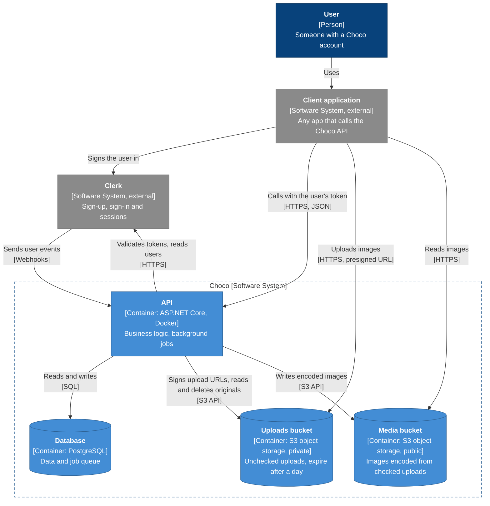

# Containers

C4 level 2: what runs and stores data inside Choco, and how the parts talk to each other and to the systems around them.

Dark blue is a person, light blue is a container inside Choco, grey is a system outside Choco. Cylinders store data; the dashed border is Choco's boundary.

| Container | Technology | Responsibility | Decided in |
| --- | --- | --- | --- |
| API | ASP.NET Core in a Docker image | All business logic. Validates tokens, signs upload URLs, builds media addresses, and runs background jobs in the same process, such as processing uploaded images. Keeps no state of its own, so it can run as many instances as needed. | [ADR 2](../adr/0002-host-the-api-on-render.md), [ADR 7](../adr/0007-run-background-jobs-from-a-postgresql-queue.md) |
| Database | PostgreSQL | The source of truth, and the queue of background jobs. Stores object keys, never media addresses. | [ADR 3](../adr/0003-use-neon-for-postgresql.md), [ADR 7](../adr/0007-run-background-jobs-from-a-postgresql-queue.md) |
| Uploads bucket | S3-compatible object storage, private | Files as clients upload them, before they are checked. Only the API reads them. Each is removed within a few days. | [ADR 9](../adr/0009-quarantine-user-uploads.md) |
| Media bucket | S3-compatible object storage, public | Images the API encoded again from checked uploads. Readable by anyone with an address, and addresses come only from the API. Keys are never reused. | [ADR 9](../adr/0009-quarantine-user-uploads.md), [ADR 10](../adr/0010-serve-media-from-a-public-bucket-behind-api-built-urls.md) |

Files never pass through the API: clients upload to the uploads bucket and read from the media bucket directly. Bucket names, keys and lifetimes are in [Object Storage](../object-storage.md).

Where each container runs is decided in [ADR 2](../adr/0002-host-the-api-on-render.md) (Render), [ADR 3](../adr/0003-use-neon-for-postgresql.md) (Neon) and [ADR 4](../adr/0004-use-backblaze-b2-for-object-storage.md) (Backblaze B2).
