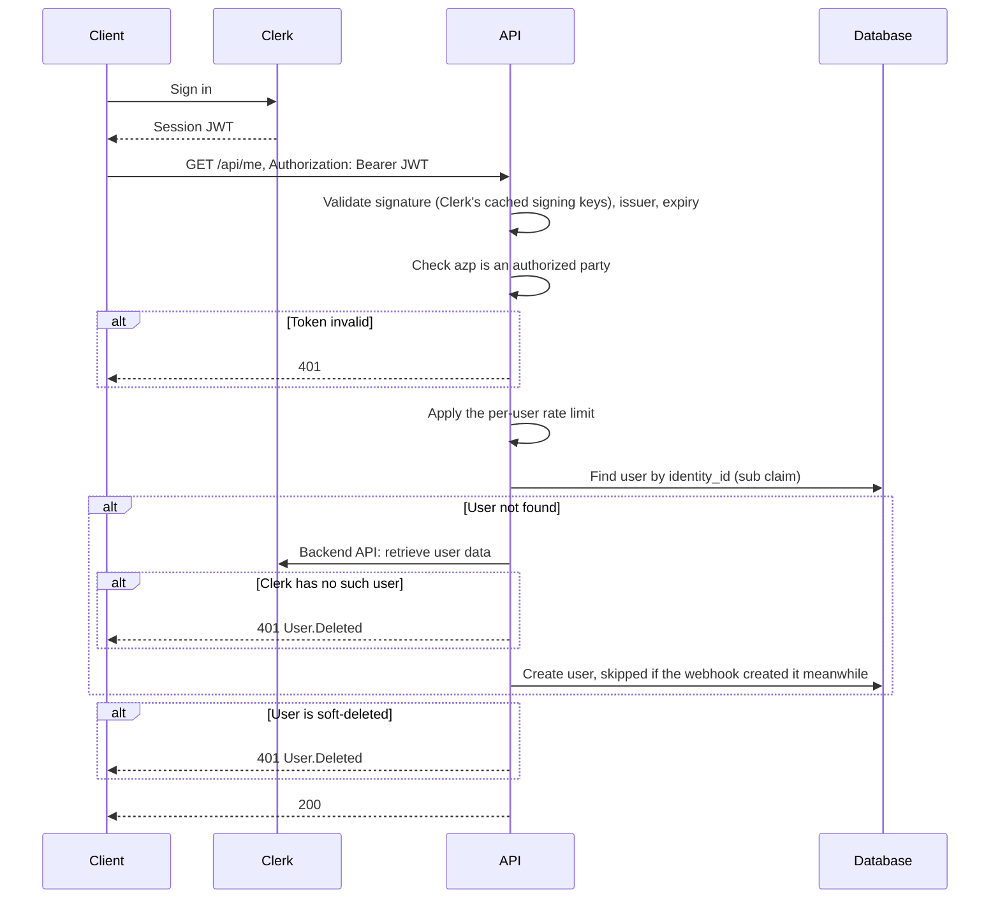
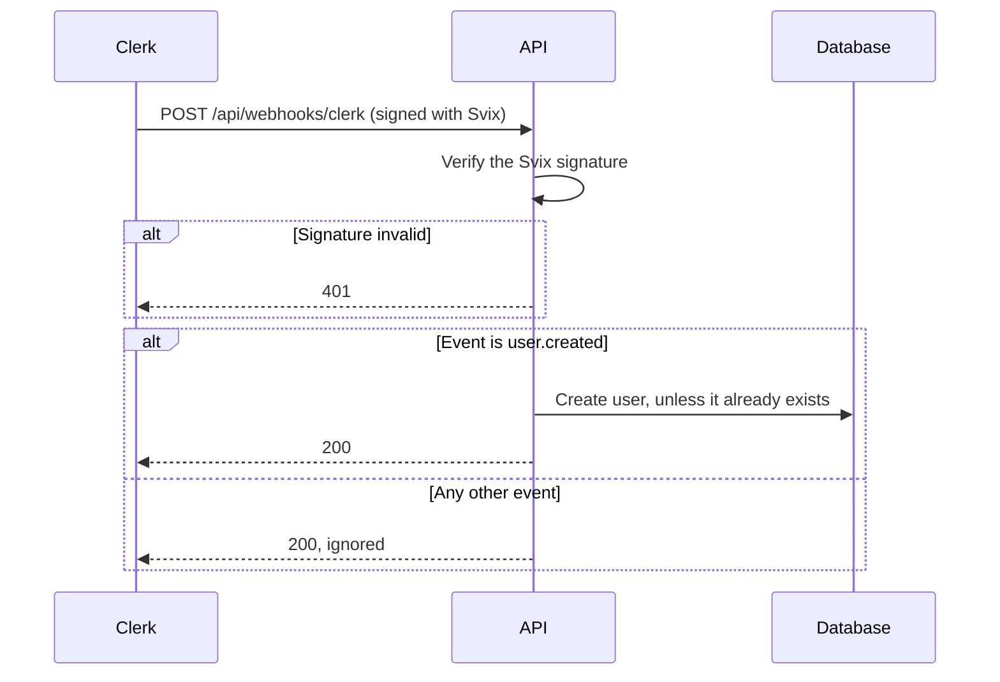

# Authentication and User Sync

How a request is authenticated, and how users in the database are kept in sync with Clerk. Both flows run independently: a user's first request can reach the API before Clerk's webhook does.

## Authenticated Request

## Clerk Webhook

## Rules

- The API never calls Clerk to check a token. It validates the token against Clerk's signing keys, which it fetches from Clerk and caches.
- Tokens must carry an `azp` claim naming one of the configured frontend origins; the audience is not checked.
- A request looks its user up by `identity_id` at most once. If the user is missing, the API reads it from Clerk's Backend API and creates it, so clients never wait for the webhook.
- Creating a user checks `identity_id` again and does nothing if the user exists. While a request is calling Clerk's Backend API, the webhook can create the same user, and this check keeps the request from failing; the request then reads the user the webhook created.
- The webhook endpoint is anonymous; the Svix signature is its only check.

## Known Gaps

- `user.updated` and `user.deleted` are ignored, so changes and deletions in Clerk never reach the database.
- A request and the webhook creating the same user at the same moment both pass the existence check; the unique index on `identity_id` rejects one of them with a 500.
- Tokens without `azp`, such as those of non-browser clients, are rejected.

How a token maps to a user, and these gaps in more detail, are in choco-api's [User Identity](https://github.com/trduc2712/choco-api/blob/main/docs/user-identity.md). Choosing Clerk is choco-api [ADR 2](https://github.com/trduc2712/choco-api/blob/main/docs/adr/0002-use-clerk-as-identity-provider.md).
