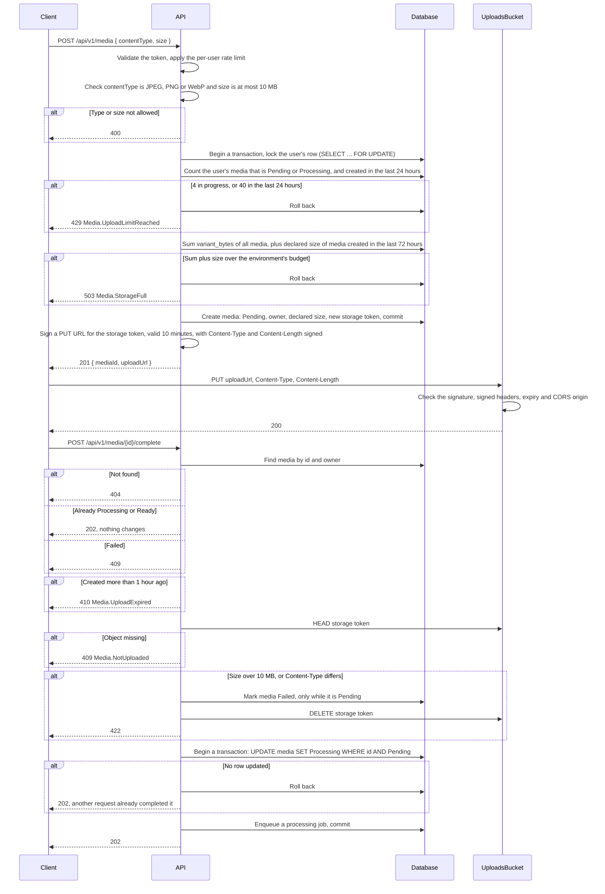
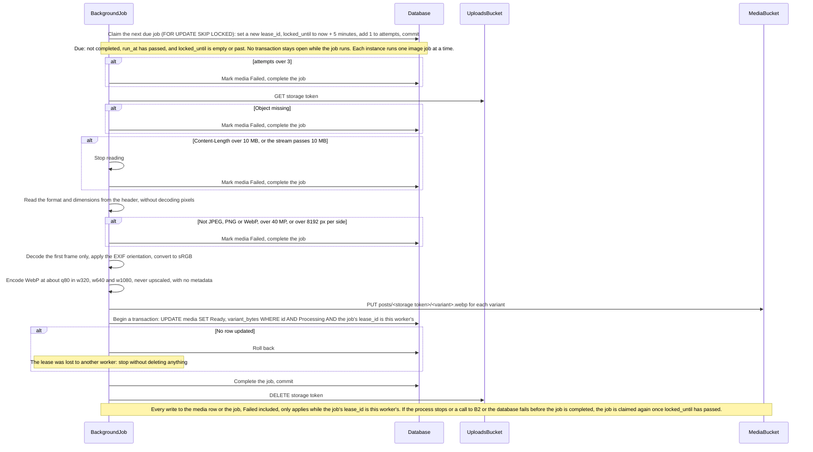
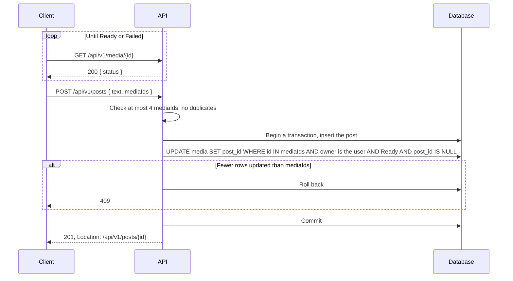
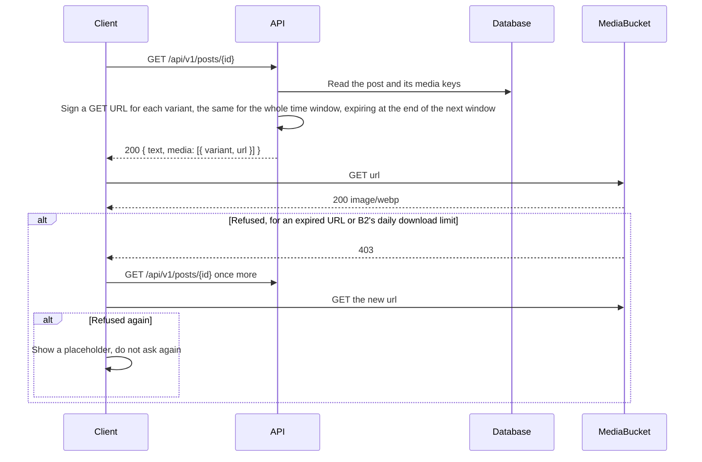
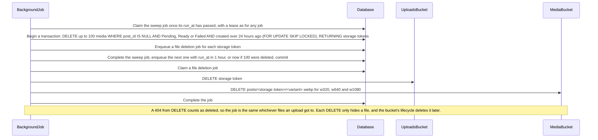

# Media Upload

How an image goes from a user's device to a post. Files never pass through the API: the client uploads to the uploads bucket, a background job checks and encodes each upload into the media bucket, and the client reads images from the media bucket. A post can only be created with images that are already ready, so no one ever sees a post whose images are still being processed.

## Upload

## Processing

## Creating a Post

## Reading

## Cleanup

## Rules

### Checks

- Every check that matters runs in the API or the job, never only in the client.
- The size the client declares is signed into the upload URL, checked again with `HEAD` at completion, and checked a third time by the job against the bytes it actually reads. The upload URL stays valid after completion, so the client can replace the file after `HEAD`; only the job's own check counts.
- The job reads the format and dimensions from the file's header before it decodes any pixel, and decodes only the first frame, so an animated or oversized image never reaches memory. A 40 MP frame is about 160 MB decoded, which is why each instance runs one image job at a time.
- Nothing is ever read from the uploads bucket except by the job. What lands in the media bucket is always pixels the job encoded itself, never the uploaded file.
- The job applies the EXIF orientation and converts to sRGB before it drops the metadata, so photos keep the way they look on the device that took them.

### Quotas

- Quotas are checked when an upload is requested, the only point before any byte reaches a bucket. They protect three hard limits: B2's 10 GB of storage and 2,500 Class B transactions a day for the whole account, and the API's 0.1 CPU and 512 MB, which every upload costs one processing job.
- A user can have at most 4 media Pending or Processing at a time, one post's worth, so no one can open many upload URLs at once.
- A user can request at most 40 uploads in 24 hours, counted from the media table. The sweep only deletes media older than 24 hours, so it never lowers the count.
- Each environment has a storage budget: 2 GB for staging and 7 GB for production, leaving 1 GB of the account for files that are hidden but not yet deleted. Used storage is the variant bytes of every media, which the job records when it marks media Ready, plus the declared size of every media created in the last 72 hours, whose original may still be in the uploads bucket. An upload that would pass the budget is refused for everyone with 503 `Media.StorageFull`. Without it, 100 users each within their own quota could still put 40 GB of originals into the uploads bucket in a day.
- The user's row is locked while counting, so two requests from the same user cannot both pass at 39. The storage budget takes no lock and can be passed slightly when many users upload at once; the 1 GB left over covers that.
- A user over their own quota gets 429 `Media.UploadLimitReached`, and a full environment gets 503 `Media.StorageFull`, so a client can tell the user which one it is.

### Expiry

- The API, not the bucket's lifecycle, decides when an upload has expired: media still Pending an hour after it was created is rejected. The upload URL is valid for 10 minutes, so an hour is enough to finish an upload, and leaves the job about 23 hours before the uploads lifecycle can hide the original.
- The lifecycle rules only remove what the API never cleaned up.

### Jobs

- Completing an upload moves media from Pending to Processing with a conditional `UPDATE` and enqueues the job in the same transaction. Two requests completing the same upload enqueue one job, and completing it again returns 202 without changing anything.
- Jobs are claimed with a lease: the claim sets a new `lease_id` and `locked_until` and commits at once, so no database connection is held while an image is downloaded, decoded and uploaded. A job whose process stopped, from a Render spin-down, a deploy or running out of memory, is claimed again when its lease ends.
- `lease_id` is a fencing token. A worker that outlived its lease finds its writes update no row, so it can never mark media Failed after another worker made it Ready.
- A job runs at most 3 times. After that its media is marked Failed.
- The original is deleted only after the media is Ready, so a retry can always read it. If the original is gone when a job runs, the media is marked Failed.
- A job that stops after marking media Ready but before deleting the original leaves the original behind. This is accepted: no one ever reads it, and the uploads lifecycle removes it within 72 hours of its upload, so it costs storage for at most three days.
- Jobs run inside the API's process ([ADR 7](../../adr/0007-run-background-jobs-from-a-postgresql-queue.md)), so while Render has the API spun down ([ADR 2](../../adr/0002-host-the-api-on-render.md)) they wait for the next request to wake it. This is accepted: the client's own polling after completing an upload is such a request, so an image is late by the time the API takes to start, up to about a minute.
- A retry writes the variants an earlier attempt already wrote. B2 hides the older version as soon as the new one is uploaded, and the media bucket's lifecycle deletes it seven days later ([Backblaze](https://www.backblaze.com/docs/cloud-storage-lifecycle-rules)), so a retry costs storage for a week, nothing more. Media is not visible until it is Ready, so no one sees a variant change.

### Cleanup

- Media not attached to a post 24 hours after it was created is deleted, whatever it reached: Pending, Ready or Failed. Media still Processing is left alone; its job ends in Ready or Failed, and the next sweep after that removes it.
- The media row is deleted, and a job to delete its files is enqueued, in one transaction. A crash between the two can therefore never leave files with no row pointing to them. This matters because the API's key cannot list either bucket, so a file the database has forgotten could never be found again.
- The file deletion job deletes every key an upload can have: the original and all three variants. A Failed upload may have written some variants before it failed, and this removes them too. A key that does not exist counts as deleted: the job treats a 404 from `DELETE` as success, so it never fails on a variant an upload never wrote, whatever B2 answers.
- A post created at the same moment as a sweep cannot keep deleted media: the sweep and the post's `UPDATE` lock the same rows, and whichever commits second finds the media gone or already attached. A post that loses gets 409.
- The sweep is a job like any other, so it runs only while the API is awake and never on two instances at once. The API enqueues it at startup unless one is already waiting, and a unique index on the waiting sweep job keeps two instances starting together from enqueuing two. It deletes at most 100 media per run and runs again at once while more are due.
- Deleted files stay hidden for seven days in the media bucket before the lifecycle removes them, so media deleted by mistake can still be restored within that week.

### Posts and Reading

- Media belongs to at most one post. The same picture uploaded twice gets two media ids.
- Attaching media to a post is one conditional `UPDATE` in the post's transaction, so a post never holds media that is not Ready, not the user's, or already used. Two posts using the same media at once both wait on the row lock, and the second updates no row and rolls back.
- A post has no processing status of its own: it is visible once created, because all its media is already Ready.
- A client has 24 hours from requesting an upload to create the post that uses it; after that the media is gone and the post gets 409.
- Retrying a failed or expired upload is up to the client: it starts again with `POST /api/v1/media`.
- The database stores keys, never addresses. Every response that refers to media carries addresses the API signed for the current time window. Each address expires at the end of the next window, so an address handed out at the last second of a window still works for a whole window.
- A client asks for new addresses once per refused image. A refusal that survives new addresses is B2's daily limit or a missing file, and asking again would only load the API.

## To Verify on Staging

- How long a job takes for a 40 MP image on Render's free instance. If it comes close to 5 minutes, jobs routinely run twice; the lease must then be longer, or renewed while the job runs.

## Known Gaps

- Whether B2 refuses a presigned `PUT` whose body length differs from the signed `Content-Length` is not checked. If it does not, one upload URL can store up to 5 GB, as many times as the client likes within 10 minutes. A single user could then fill the account's 10 GB, shared by every environment, and block every upload and every processing job until the uploads lifecycle has removed the files, up to 72 hours later.
- Quotas and the storage budget count the size the client declares. Until it is known that B2 enforces the signed `Content-Length`, a client that declares 1 KB and uploads more is not stopped by them.
- How much space the three variants of an image take has not been measured, so how many images fit in each budget is not known yet; about 250 KB per image is an estimate.
- A job whose process stopped waits up to 5 minutes for its lease to end, so its image is late by that much.
- An image that runs the instance out of memory takes the API down with it, up to 3 times before its media is Failed.

Why uploads are quarantined is [ADR 9](../../adr/0009-quarantine-user-uploads.md), the job queue is [ADR 7](../../adr/0007-run-background-jobs-from-a-postgresql-queue.md), and why media is served through signed addresses is [ADR 12](../../adr/0012-serve-media-from-a-private-bucket-through-api-signed-urls.md). Bucket names, keys and lifecycles are in [Object Storage](../../object-storage.md).
