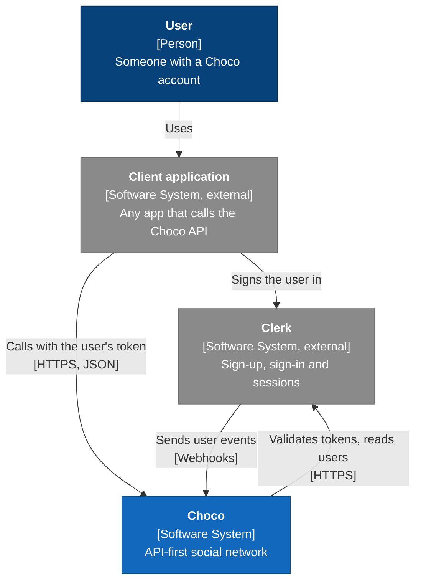

# System Context

C4 level 1: Choco as one box, the people who use it, and the software systems it depends on.

Dark blue is a person, blue is Choco, grey is a system outside Choco.

| Element | Type | Responsibility |
| --- | --- | --- |
| User | Person | Has one account. There is only one kind of user. |
| Client application | Software system, external | Any app that calls the API, including a first-party web or mobile app. Choco is API-first, so every client is outside it. |
| Choco | Software system | Profiles, follows, posts, feed, likes, comments and notifications. |
| Clerk | Software system, external | Owns identity: sign-up, sign-in, sessions, avatars. Choco never sees a password. |

What Choco is made of is in [Containers](containers.md).
